# My-Workout

## 🌍 Language / Langue

[🇺🇸 English](README.md) | [🇫🇷 Français](README.fr.md)

## Introduction

My-Workout est une application de suivi pour les pratiquants de musculation. Elle permet d'enregistrer et de suivre une progression sur une série d'exercices. Vous pouvez enregistrer le nombre de répétitions, de séries et la charge utilisée. Ces séances peuvent être visualisées depuis un calendrier et un graphique de progression par exercice.

Vous pouvez définir un programme en choisissant vos exercices depuis une bibliothèque et agencer votre séance en choisissant l'ordre de vos exercices.

## Fonctionnalités

- Bibliothèque d'exercices avec description et animation du mouvement
- Sélection d'exercices pour chaque groupe musculaire parmi ceux présents dans la bibliothèque
- Gestion des salles de sport, pour répartir votre historique et votre progression par lieu d'entraînement
- Calendrier de suivi de séances
- Enregistrement d'une séance avec le nombre de séries, de répétitions et la charge utilisée lors de l'exercice
- Chronomètre intégré à l'entraînement pour les temps de repos
- Suggestion de séance
- Graphiques de progression par exercice
- Personnalisation de l'application parmi 17 thèmes de couleur + mode sombre
- Authentification
- Installable en PWA, avec support hors-ligne

### Bibliothèque

L'application recense environ 190 exercices dans la bibliothèque. Chacun de ces exercices peut être ajouté à un entraînement et vous sera affiché lors de vos entraînements afin d'enregistrer la séance.

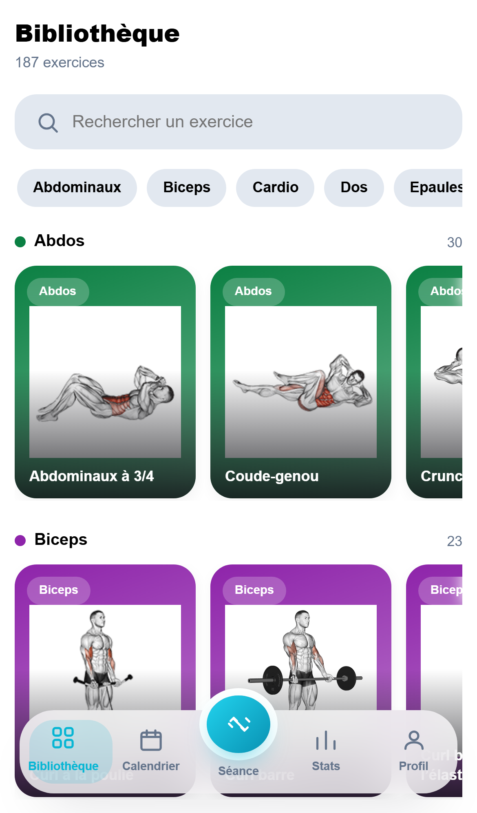

Des filtres sont disponibles pour chaque groupe musculaire pour cibler une portion précise d'un muscle.

### Détail d'un exercice

Vous pouvez cliquer sur un exercice pour y afficher une description ainsi qu'une animation du mouvement.

En bas de la page, vous aurez de nouveau la possibilité d'ajouter / supprimer cet exercice de la séance.

### Salles de sport

Avant de pouvoir enregistrer une séance, il vous faut au moins une salle (ex. « Basic-Fit », « Salle à la maison »). Chaque séance est rattachée à l'une d'elles, ce qui permet de filtrer votre historique, votre calendrier et vos graphiques de progression par lieu d'entraînement.

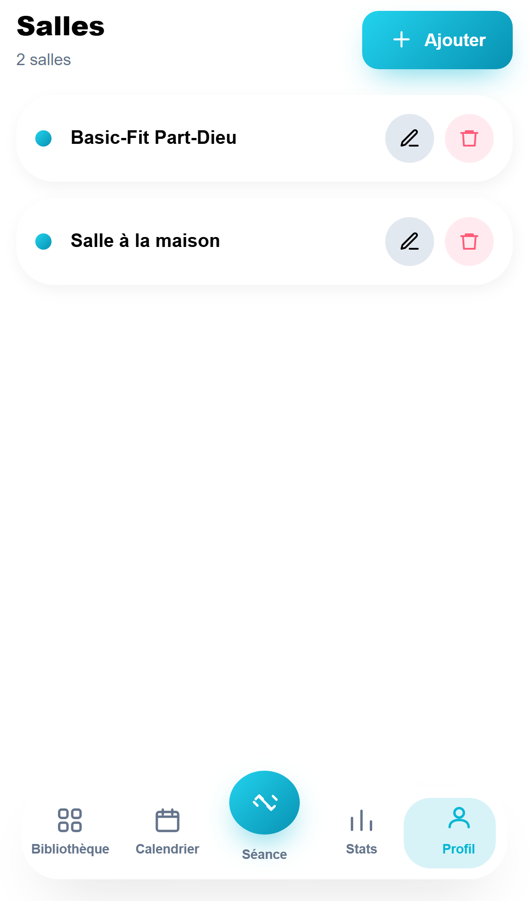

## Enregistrer une séance

Cette partie de l'application concerne l'enregistrement d'une séance. Il s'agit du point clé de l'application.

#### 1. Sélectionner un entraînement

Vous pourrez ici choisir un groupe musculaire à travailler et démarrer une séance (cardio compris). L'application recommande la plus ancienne des séances effectuées, et vous demande dans quelle salle vous vous entraînez si vous en avez plusieurs.

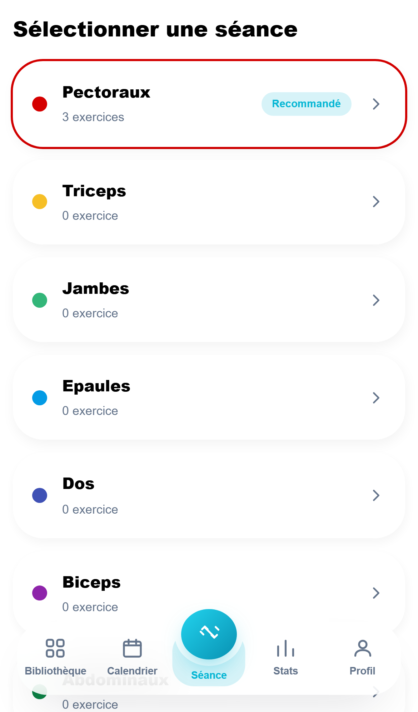

#### 2. Séance & chronomètre

Vous retrouverez tout en haut de l'écran les exercices à effectuer durant la séance choisie (triés selon votre préférence définie depuis la bibliothèque). Vous pouvez changer d'exercice en cliquant sur une étape ou en swipant vers la gauche / droite.

Augmentez / diminuez la charge utilisée via les boutons + ou - ou en entrant un nombre dans le champ. Même principe pour les répétitions. Le champ est pré-rempli avec la dernière charge utilisée pour cet exercice.

Une fois votre série effectuée, appuyez sur le chronomètre pour le lancer ; appuyez de nouveau dessus pour l'arrêter et enregistrer la série avec son temps de repos dans le tableau ci-dessous. Répétez ce principe jusqu'à vouloir changer d'exercice.

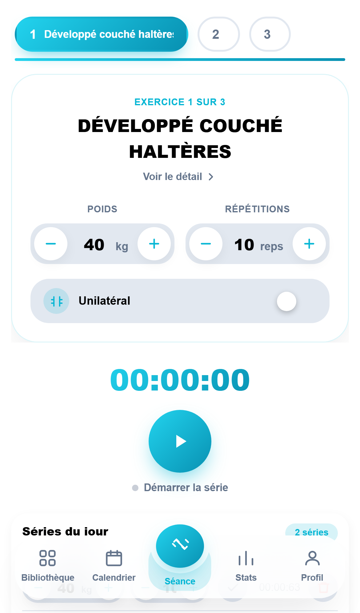

### Calendrier

Le calendrier répertorie l'ensemble des séances réalisées. Vous pouvez filtrer par groupe musculaire pour n'afficher que lui, et swiper vers la gauche / droite pour changer de mois.

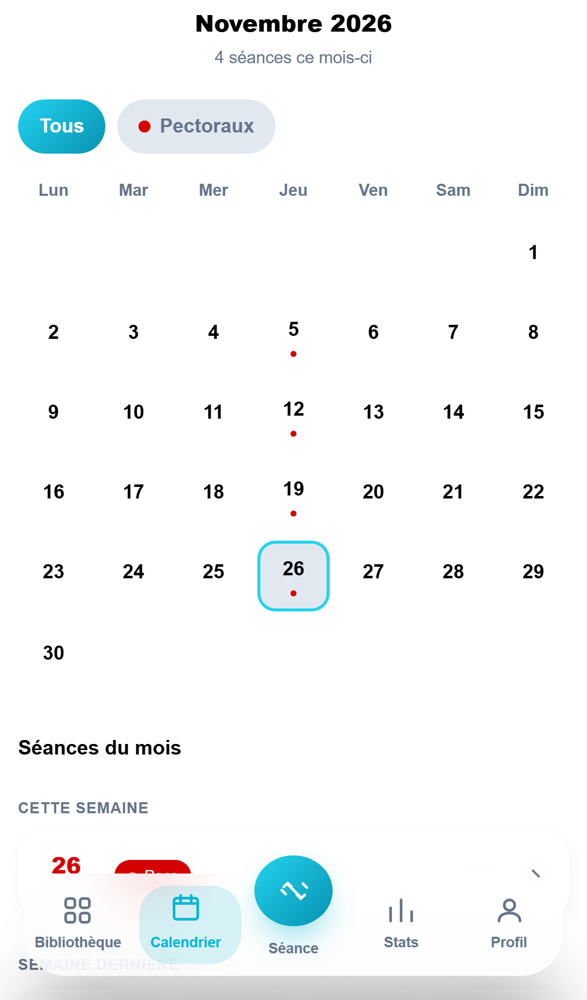

Cliquer sur un jour en affiche le détail : chaque exercice réalisé ce jour-là, regroupé par salle, avec les séries enregistrées pour chacun.

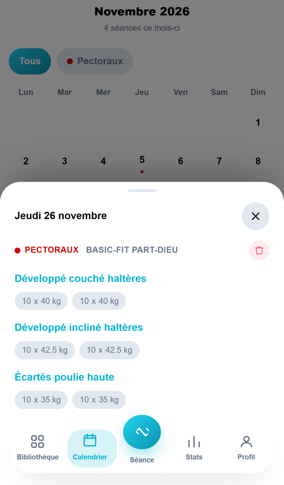

### Statistiques

La section statistiques affiche la liste des exercices que vous avez suivis, regroupés par groupe musculaire.

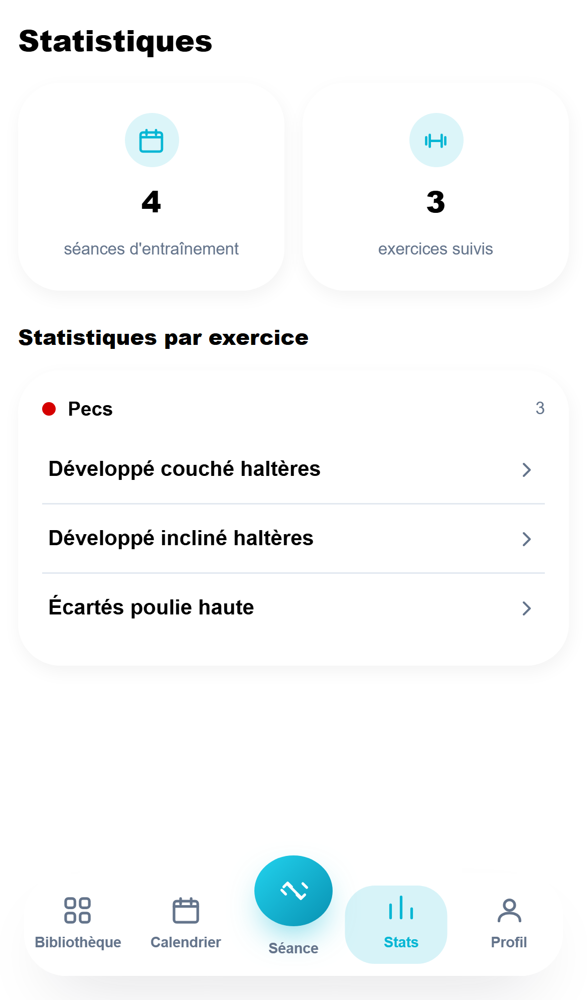

En cliquant sur un exercice, vous visualisez votre progression : charge utilisée dans le temps (filtrable par période et par salle), poids total soulevé, répétitions totales et votre charge maximale.

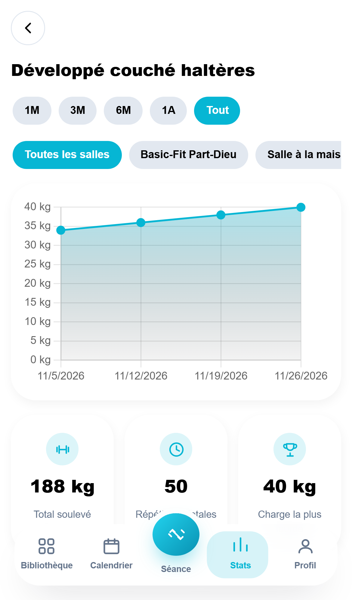

### Mon compte

La section mon compte permet de modifier votre email / mot de passe, de gérer vos salles, et de choisir votre thème parmi les 17 couleurs proposées ainsi que le mode sombre.

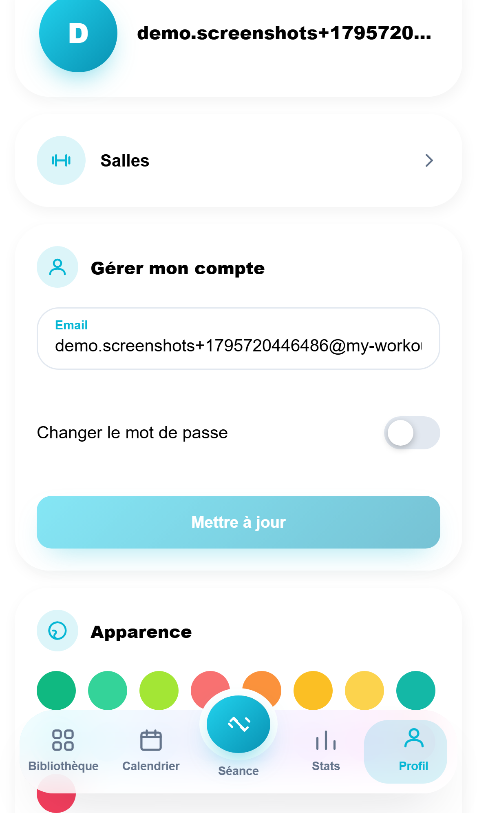

### Authentification

L'application propose une authentification pour sauvegarder vos données. Vous pouvez vous connecter avec un compte déjà existant ou en créer un nouveau. Vos données sont sauvegardées côté serveur et accessibles depuis n'importe quel appareil.

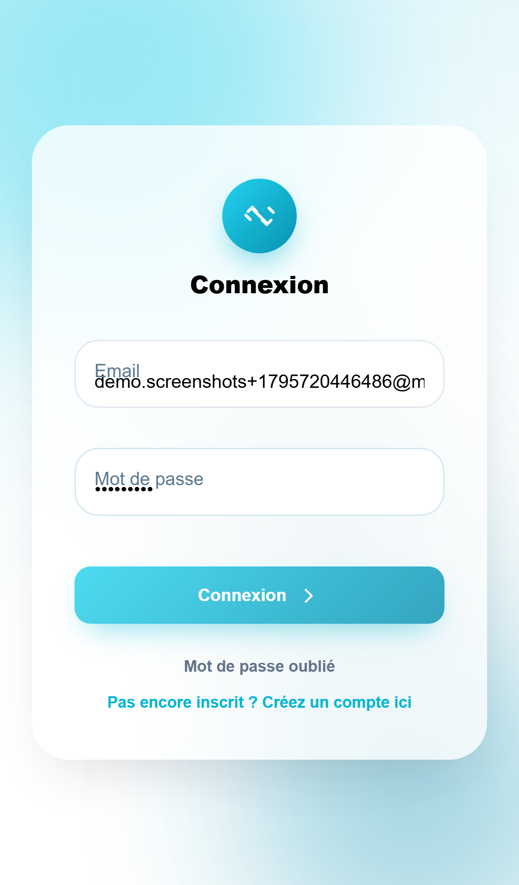

Créez un compte en remplissant le formulaire avec votre email et mot de passe.

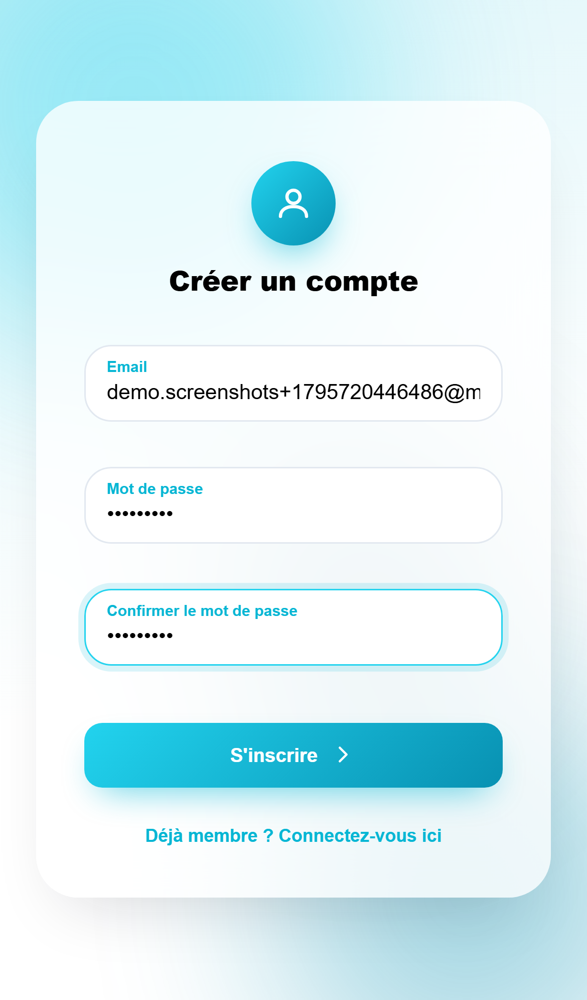
