# My-Workout

## 🌍 Language / Langue

[🇺🇸 English](README.md) | [🇫🇷 Français](README.fr.md)

## Introduction

My-Workout is a tracking app for weightlifters. It allows you to record and track progress across a series of exercises. You can log the number of repetitions, sets, and the weight used. These sessions can be viewed from a calendar and a progression graph per exercise.

You can define a workout program by choosing your exercises from a library and arranging your session by selecting the order of your exercises.

## Features

- Exercise library with description and movement animation
- Exercise selection for each muscle group from those available in the library
- Gym management, to split your history and progress by training location
- Workout tracking calendar
- Session logging with number of sets, reps, and weight used for each exercise
- Built-in timer for rest periods
- Workout suggestions
- Per-exercise progress graphs
- App customization with 17 color themes + dark mode
- Authentication
- Installable as a PWA, with offline support

### Library

The app includes around 190 exercises in the library. Each of these exercises can be added to a workout and will be displayed during your training sessions so you can log your progress.

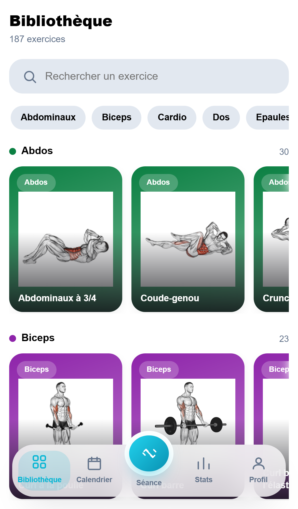

Filters are available for each muscle group to target a specific portion of a muscle.

### Exercise detail

You can click on an exercise to display its description as well as an animation of the movement.

At the bottom of the page, you will again have the option to add/remove this exercise to/from your session.

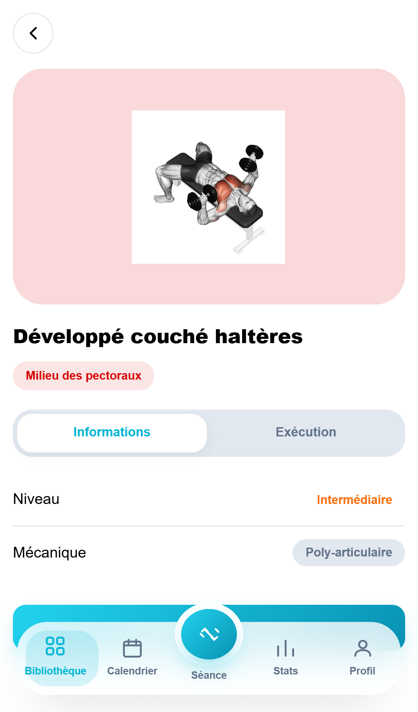

### Gyms

Before logging a session, you need at least one gym (e.g. "Basic-Fit", "Home gym"). Every workout is tied to one, so your history, calendar and progress graphs can be filtered by training location.

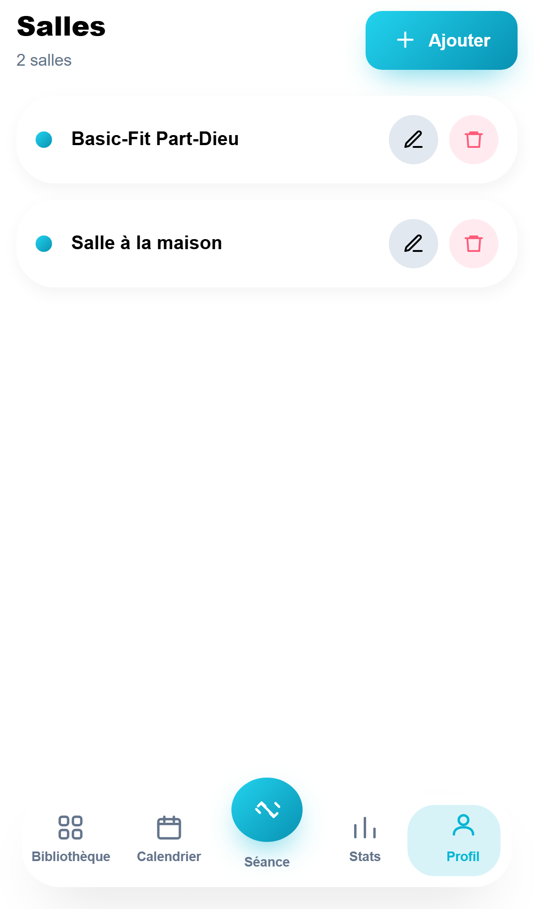

## Log a Session

This part of the app concerns session logging. It is the key feature of the application.

#### 1. Select a Workout

Here you can choose a muscle group to train and start a session (including cardio). The app recommends the oldest session performed, and asks which gym you're training at if you have more than one.

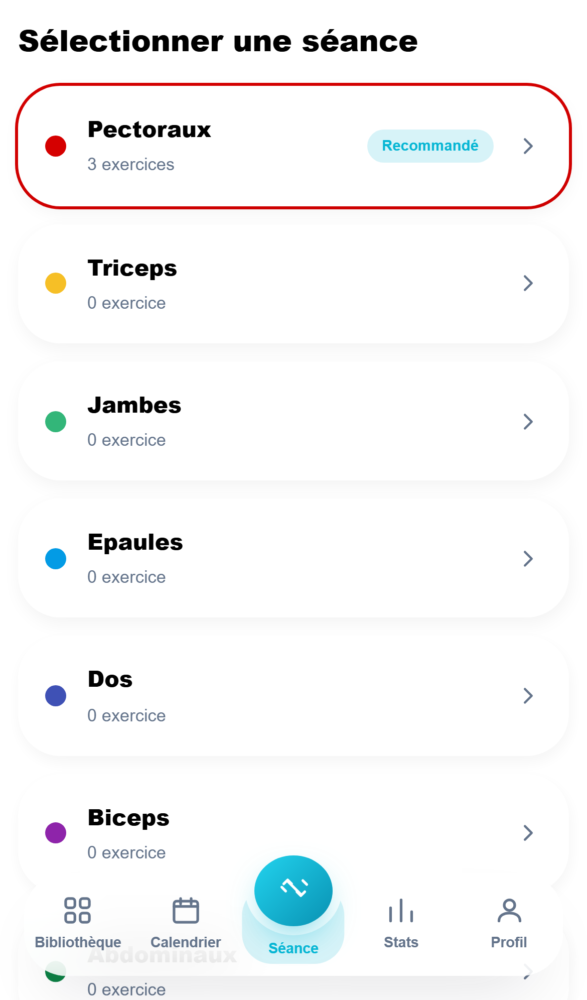

#### 2. Session & Timer

At the top of the screen, you will see the exercises to be performed during the chosen session (sorted according to your preference set in the library). You can switch exercises by tapping a step or swiping left/right.

Increase/decrease the weight used via the + or - buttons or by entering a number in the field. Same principle for repetitions. The field is pre-filled with the last weight used for this exercise.

Once your set is complete, tap the timer to start it; tapping it again stops it and logs the set with its rest time in the table below. Repeat this process until you want to switch to another exercise.

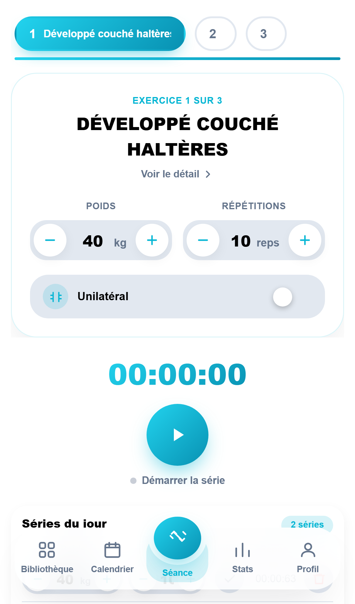

### Calendar

The calendar lists all completed sessions. You can filter by muscle group to display only that group, and swipe left/right to change months.

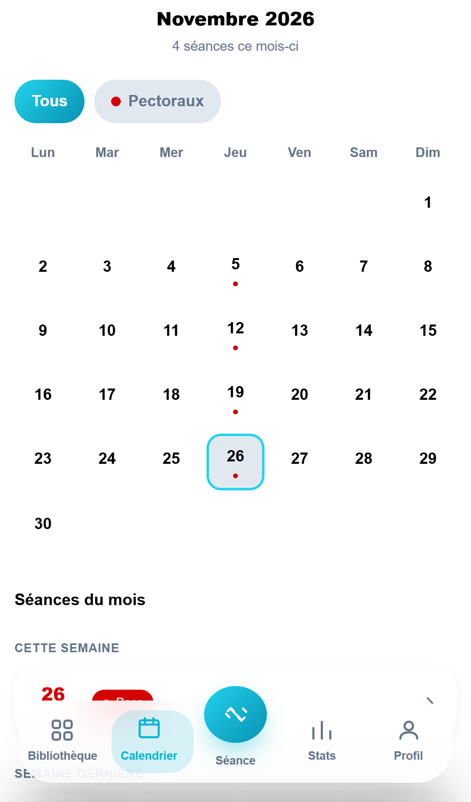

Tapping a day opens its detail: every exercise trained that day, grouped by gym, with the sets logged for each.

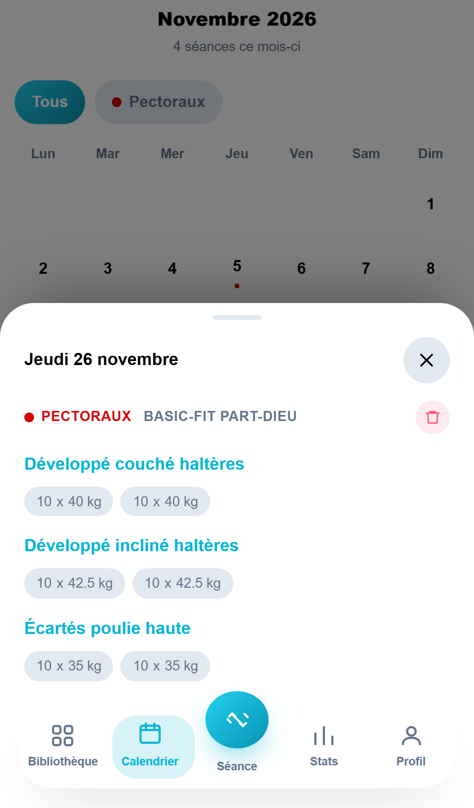

### Statistics

The statistics section lists the exercises you've tracked, grouped by muscle group.

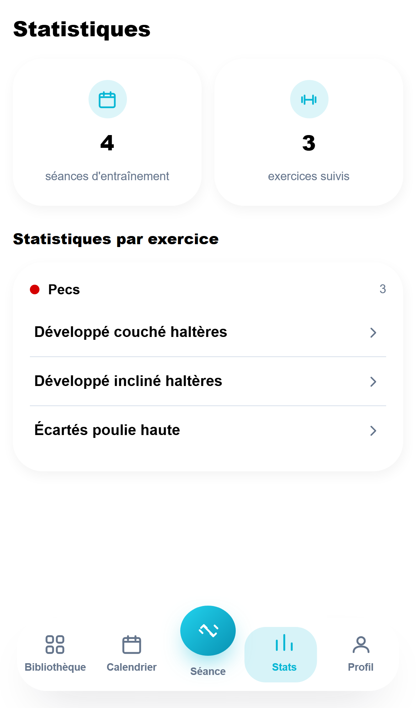

Tapping an exercise shows your progression: weight used over time (filterable by period and by gym), total weight lifted, total reps, and your best load.

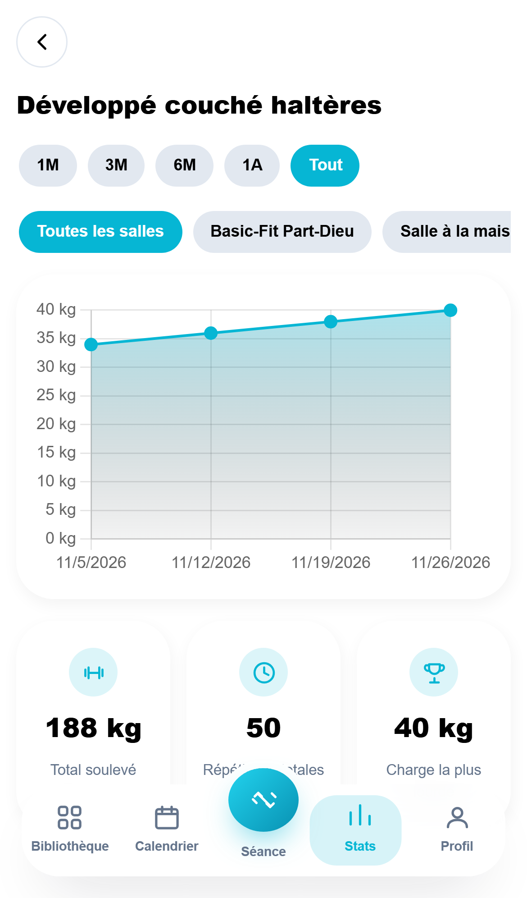

### My Account

The account section lets you update your email/password, manage your gyms, and pick your theme among the 17 available color presets plus dark mode.

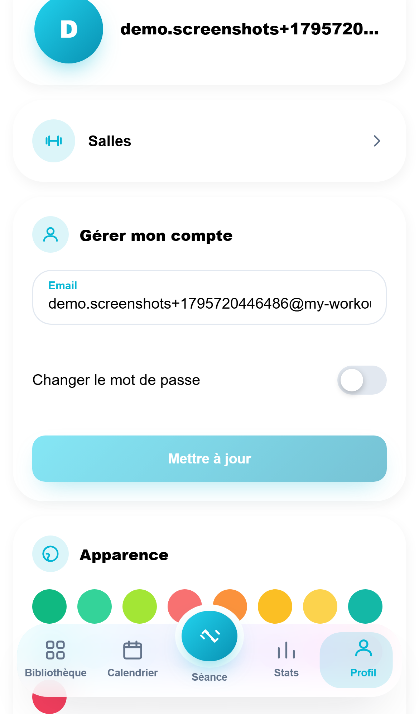

### Authentication

The app provides authentication to save your data. You can log in with an existing account or create a new one. Your data is saved server-side and accessible from any device.

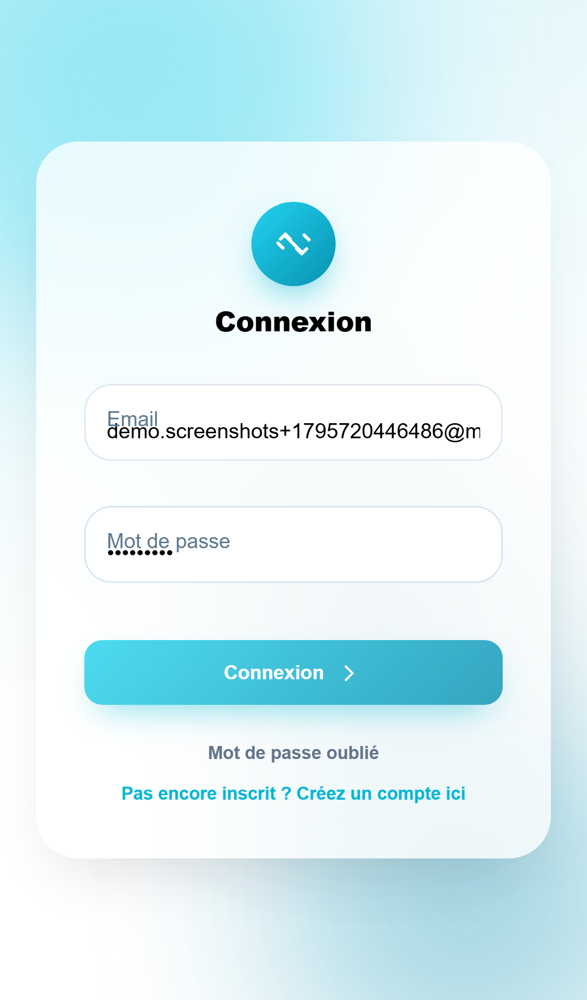

Create an account by filling in the form with your email and password.

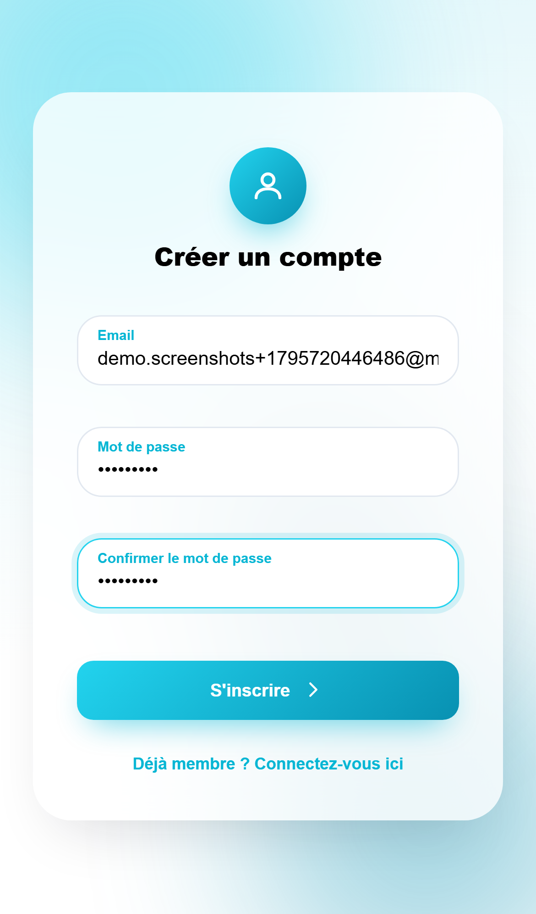
